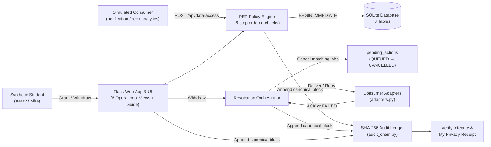
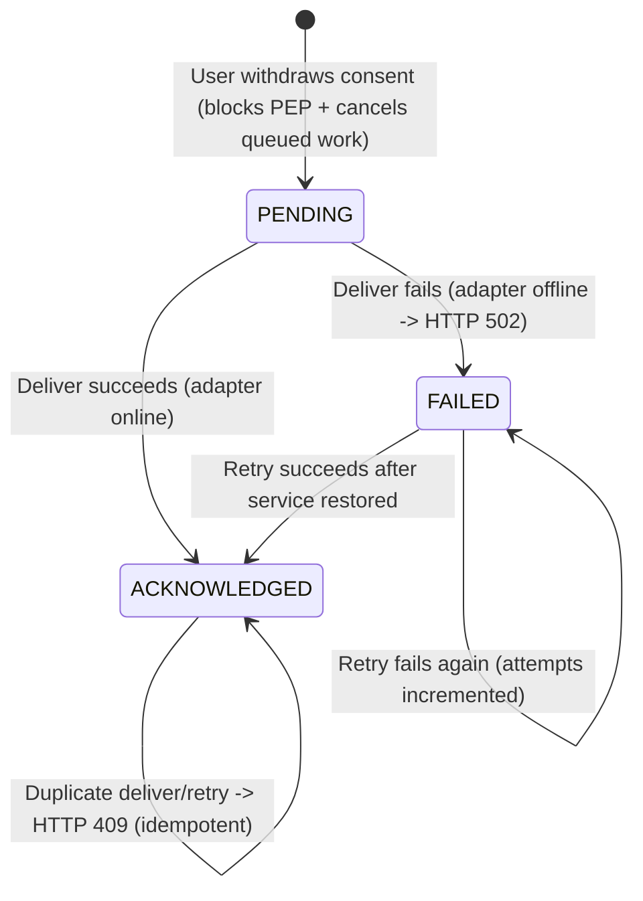

# ConsentX Master Demo & Architecture Guide (`DEMO.md`)

> **Version:** 2.0.0 · **Problem Statement:** PS-002 — Purpose-Based Consent Recording & Withdrawal Prototype  
> **Synthetic Service:** CampusPulse (University Event Platform)  
> **Run locally:** `http://127.0.0.1:5001` · **In-app guide:** Click **Judge Tour** in the top bar or open **Judge Guide** in the sidebar.

---

## 1. The Big Picture — What Problem Does PS-002 Solve?

Imagine a university student, **Aarav**, signs up for **CampusPulse** and allows the app to send him event reminders.  
Two weeks later, Aarav changes his mind and clicks **Withdraw**.

In many real apps, here is what happens behind the scenes:

```text
Typical broken app:
  User clicks "Withdraw" ──▶ Database updates checkbox to "withdrawn"
                             (AND STOPS THERE!)
                             ❌ Reminder jobs already in the queue still fire.
                             ❌ Downstream services never hear about the withdrawal.
                             ❌ Next API call might still read stale cached consent.
                             ❌ User has zero proof anything actually stopped.
```

**That exact failure is what PS-002 asks us to solve.**

Data protection laws like **India's Digital Personal Data Protection (DPDP) Act, 2023** and **GDPR** require two technical guarantees:
1. **Purpose limitation:** Saying "yes" to *Event reminders* does **not** give permission for *Personalized recommendations* or *Usage analytics*.
2. **Enforceable withdrawal:** When a user withdraws consent, data sharing must stop **at request time**, and downstream workflows must react—not ignore the database flag.

**ConsentX** is a working synthetic prototype built to demonstrate and prove that entire lifecycle—from user choice, to strict server-side API enforcement, to cancelling queued work, notifying downstream services, handling outages/retries honestly, issuing a user receipt, and proving nothing was altered in a tamper-evident SHA-256 ledger.

> **Honest Scope Note:** ConsentX uses **synthetic users and synthetic data only**. It demonstrates **technical consent enforcement and auditability** as required by PS-002—it does **not** claim legal certification or universal GDPR/DPDP compliance.

---

## 2. PS-002 Requirements Checklist (`R-01` to `R-11`) & How ConsentX Solves Each

Source: `../PS-002.pdf`

| Req ID | What PS-002 Requires | How ConsentX Solves It | Where to See It in UI | Automated Tests |
|---|---|---|---|---|
| **R-01** | One synthetic service + synthetic users | **CampusPulse** with 2 session-pinned synthetic users: `student-001` (Aarav Demo) and `student-002` (Mira Demo). Zero real personal data. | Topbar identity selector & Dashboard | `test_02`, `test_25`, `test_36` |
| **R-02** | Exactly 3 separate data-sharing purposes | `P1` Event reminders, `P2` Personalized event suggestions, `P3` Anonymous usage analytics—stored and evaluated independently. | Dashboard & **Consent & revocation** | `test_02`, `test_06`, `test_07` |
| **R-03** | Record grant and withdrawal events | Append-only `consent_events` table—withdrawals add a new event instead of deleting prior grants. | **Consent & revocation** & **Audit** | `test_04`, `test_08`, `test_14` |
| **R-04** | Versioned privacy notices with content hash | Every notice has a version (`1.0`, `2.0`…) and SHA-256 digest of its exact text. Publishing a change invalidates older grants (`NOTICE_MISMATCH`). | **Notice versions** | `test_10`, `test_11`, `test_17`, `test_28` |
| **R-05** | Mock downstream API checks consent at request time | `POST /api/data-access` runs 6 server checks (identity, purpose, consumer+operation+fields, latest consent, notice hash, payload release) on every request. | **Data access simulator** | `test_03`, `test_05`, `test_26`, `test_29`–`test_32` |
| **R-06** | Withdrawal blocks subsequent requests + leaves other purposes intact | Withdrawing `P1` immediately returns `HTTP 403 CONSENT_WITHDRAWN` (`payload: null`) while `P2` and `P3` continue working. | **Consent & revocation** → **Simulator** | `test_08`, `test_09`, `test_27`, `test_44` |
| **R-07** | Audit records + JSON and CSV exports | Unified audit timeline (`consent`, `access`, `system` events) + tamper-evident SHA-256 `audit_ledger` + filtered JSON/CSV export. | **Audit & verification** | `test_14`–`test_16`, `test_20`–`test_24`, `test_39`–`test_42` |
| **R-08** | At least 12 automated lifecycle tests | **52 automated tests** running on isolated temporary SQLite databases (4.3x the minimum requirement). | **Audit & verification** (suite summary + Live Diagnostics) | `test_01`–`test_52` |
| **R-09** | End-to-end demonstration flow | Grant → Allow → Withdraw → Deny + Queue Cancel + Adapter Ack/Retry → Receipt → Notice v2 stale deny → Re-consent + Verify Ledger. | **Judge Tour** bar (7 live steps) | Full suite + `WALKTHROUGH.md` |
| **R-10** | Pseudocode matching actual enforcement logic | Exact request-time + revocation pseudocode aligned line-for-line with `app.py`. | `docs/DEMO_PSEUDOCODE.md` | Verified against `app.py` |
| **R-11** | Submission packaging (private repo, PDF, mentor demo) | `DEMO.md`, `docs/`, `evidence/test-results.txt`, and `render.yaml` ready; final repo transfer & structure PDF tracked in `PROGRESS.md`. | `docs/PROGRESS.md` | Manual submission checklist |

---

## 3. Why ConsentX Is More Than a Static Checkbox (Our USP)

If a judge asks *"Isn't this just a toggle UI on top of mock JSON?"*, here is the concrete proof of why ConsentX goes far deeper than a typical static or database-only consent toggle:

| Capability | Typical Static Checkbox | Basic Consent DB Toggle | **ConsentX v2.0** |
|---|---|---|---|
| Purpose count matches PS-002 (exact 3) | Often hardcoded | 3–4 purposes | ✅ **Strict 3 (`P1`–`P3`)** |
| Consumer service identity in API request | ❌ | ❌ | ✅ **`notification`, `recommendation`, `analytics`** |
| Field-level scope authorization (`student_email` blocked) | ❌ | ❌ | ✅ **`FIELD_SCOPE_EXCEEDED`** |
| Operation-level check (`READ` vs `WRITE`) | ❌ | ❌ | ✅ **`OPERATION_NOT_ALLOWED`** |
| 6-step server decision trace | ❌ | ❌ | ✅ **Full explainable trace** |
| Cancels already-queued background jobs on withdrawal | ❌ | ❌ | ✅ **Purpose- & user-scoped cancellation** |
| Independent consumer adapter delivery & acknowledgement | ❌ | ❌ | ✅ **Persisted `adapter_event_id` + digest** |
| Simulated consumer outage (`FAILED`) & idempotent `RETRY` | ❌ | ❌ | ✅ **Honest failure state + `409` idempotency** |
| Student-facing **My Privacy** + downloadable JSON/PDF **Receipt** | ❌ | ❌ | ✅ **Full evidence receipt + disclaimer** |
| Tamper-evident SHA-256 hash-chain verification | ❌ | Rare | ✅ **Unified 12-event SHA-256 ledger** |
| In-browser live diagnostic suite | ❌ | Rare | ✅ **8 live backend checks + 51 unit tests** |
| Persistent database in deployment | ❌ | Often ephemeral | ✅ **Render persistent disk (`/var/data`)** |

**One-line USP for judges:**  
> *"Most consent demos stop when a checkbox flips to Withdrawn. ConsentX proves what happens next: future requests are blocked at field granularity, matching queued jobs are cancelled, downstream consumer adapters actually receive and acknowledge the withdrawal (or honestly report failure until retried), the student gets a verifiable receipt, and every step is sealed in a SHA-256 hash chain."*

---

## 4. Every Single Feature Explained (What · Why · How · Try It)

### Feature 1: Session-Pinned Synthetic Identity
- **What it is:** Top-bar identity switcher (`Aarav Demo` / `Mira Demo`) backed by a signed Flask cookie session.
- **Why it exists:** Without server-side identity pinning, a malicious caller could pass `"user_id": "student-002"` inside JSON and read or overwrite someone else's consent.
- **How it works:** Selecting an identity calls `POST /api/demo-session`, storing `user_id` in the server session and resetting `role` to `student`. Every API checks `identity_error(user_id)` and rejects mismatches with `HTTP 403 IDENTITY_MISMATCH`.
- **Try it:** Grant `P1` for Aarav, switch to Mira, and verify Mira's `P1` is still `Not granted` and Aarav's withdrawal receipts cannot be accessed by Mira.

### Feature 2: Three Independent Purposes & Append-Only Consent History
- **What it is:** Separate cards for `P1` (Event reminders), `P2` (Personalized suggestions), and `P3` (Anonymous usage analytics).
- **Why it exists:** PS-002 requires strict purpose isolation—consent for reminders must never authorize recommendations or analytics.
- **How it works:** `POST /api/consent` inserts a new immutable row into `consent_events` (linked to the active notice version + SHA-256 hash) rather than overwriting a boolean flag. The latest row per `(user_id, purpose_id)` determines active state.
- **Try it:** Grant `P1` only; observe `P2` and `P3` stay `Not granted`.

### Feature 3: Consumer-, Operation-, and Field-Scoped Policy Enforcement Point (PEP)
- **What it is:** The **Data access simulator** (`POST /api/data-access`) where downstream services ask for specific fields.
- **Why it exists:** Real data leaks happen when a service authorized for *event reminders* asks for `student_email` (field overreach), tries to `WRITE` instead of `READ`, or an analytics service asks for reminder fields.
- **How it works:** Inside a write-locked SQLite transaction (`BEGIN IMMEDIATE`), `data_access()` evaluates 6 ordered checks:
  1. Valid pinned synthetic user
  2. Valid purpose (`P1`–`P3`)
  3. Consumer allowed for that purpose + `operation == "READ"` + `requested_fields ⊆ allowed_fields`
  4. Latest consent event is `grant`
  5. Consent's notice version & SHA-256 match the active notice
  6. Filter payload to *only* requested fields (`ALLOW` = `200`, `DENY` = `403` with `payload: null`).
- **Try it:** Use the 4 one-click **Quick demo scenarios** in the Simulator (`Valid P1 read`, `Field overreach (student_email)`, `Wrong consumer mismatch`, `Unauthorized WRITE`).

### Feature 4: Synthetic Queued Work & Purpose-Scoped Cancellation
- **What it is:** Each user starts with 2 queued synthetic jobs per purpose (`event_reminder`, `event_recommendation`, `analytics_export`) in `pending_actions`.
- **Why it exists:** When a user withdraws consent for reminders, reminders already sitting in the queue must be cancelled—without touching unrelated recommendation or analytics jobs.
- **How it works:** Inside the same transaction as withdrawal, ConsentX runs `UPDATE pending_actions SET status='CANCELLED' ... WHERE user_id=? AND purpose_id=? AND status='QUEUED'` and links each cancelled row to the new `revocation_id`. Re-granting replenishes queued work if 0 jobs are queued, or you can click **+ Queue P1 job** manually.
- **Try it:** Grant `P1` & `P2`, withdraw `P1`, and check **Queued & cancelled work**: `P1` reminders become `CANCELLED`, while `P2` and `P3` stay `QUEUED`.

### Feature 5: Independent Consumer Adapters, Simulated Outages & Idempotent Retry
- **What it is:** Three persistent simulated consumer services (`notification-service`, `recommendation-service`, `analytics-service`) defined in `adapters.py` and persisted in `consumer_services`.
- **Why it exists:** Blocking future API calls isn't enough if the connected downstream consumer never receives or acknowledges the withdrawal. And if that service is down, the UI must **never fake a green success status**.
- **How it works:**
  - Withdrawing creates a `PENDING` job in `revocation_jobs`.
  - Clicking **Deliver to service** calls `POST /api/revocations/<id>/deliver`:
    - If the consumer is **ONLINE**, it records `DELIVERED → ACKNOWLEDGED`, generates a unique `ACK-...` event ID + SHA-256 receipt digest, and logs both events to `audit_ledger`.
    - If the consumer is **OFFLINE** (toggled via **Simulate service outage**), it returns `HTTP 502`, records `status='FAILED'`, increments `attempts`, and keeps the job honestly unresolved.
  - Restoring the service and clicking **Retry delivery** (`POST /api/revocations/<id>/retry`) transitions `FAILED → ACKNOWLEDGED`.
  - Calling deliver/retry on an already-acknowledged job returns `HTTP 409 ALREADY_ACKNOWLEDGED` (strict idempotency).
- **Try it:** Take `notification-service` offline → withdraw `P1` → click **Deliver to service** (see `FAILED`) → restore service online → click **Retry delivery** (see `ACKNOWLEDGED`).

### Feature 6: My Privacy View & Downloadable Privacy Receipts
- **What it is:** A dedicated student-facing **My Privacy** screen (`GET /api/my-privacy`) plus downloadable **JSON** and **Printable HTML/PDF** receipts (`GET /api/privacy-receipt/<id>`).
- **Why it exists:** Consent governance shouldn't only be an operator dashboard. The student needs to see who has access to which fields, whether any withdrawal is still unresolved, and download cryptographic proof.
- **How it works:** Aggregates permissions, connected services, field tags, and withdrawal statuses, and builds a self-contained receipt with `withdrawal_id`, notice version + SHA-256, cancelled job IDs, delivery attempts, `adapter_event_id`, linked `audit_ledger` IDs, and an explicit scope disclaimer (*acknowledgement confirms the simulated service processed the instruction; it does not prove erasure of every previously shared copy*).
- **Try it:** Open **My Privacy**, check the unresolved warning banner (before delivery) vs. green acknowledged status (after delivery), and click **Printable receipt** or **JSON receipt**.

### Feature 7: Operator-Gated Privacy Notice Versioning
- **What it is:** Notice version manager (`POST /api/notices`) protected by `CONSENTX_OPERATOR_TOKEN`.
- **Why it exists:** Students should not be able to edit the organization's privacy policy. When an operator publishes a changed notice (`v2.0`), old consents cannot silently carry forward.
- **How it works:** Unlocking via `POST /api/operator-session` uses `secrets.compare_digest` against `CONSENTX_OPERATOR_TOKEN`. Publishing calculates the SHA-256 hash of the exact text, rejects unchanged text (`400`) or duplicate versions (`409`), and logs `NOTICE_PUBLISHED`. Any prior `v1.0` grant now triggers `NOTICE_MISMATCH` until re-confirmed.
- **Try it:** In **Notice versions**, enter the local operator token (`demo-operator-secret` when launched with our quick-start command), edit one word, publish `v2.0`, then test `P1` in the Simulator to see `NOTICE_MISMATCH`.

### Feature 8: Unified Tamper-Evident SHA-256 Audit Ledger & Live Diagnostics
- **What it is:** An append-only cryptographic ledger (`audit_ledger` in `audit_chain.py`) + **Verify audit integrity** button + **Run live diagnostics** runner + filtered JSON/CSV export.
- **Why it exists:** Judges expect proof that audit logs haven't been silently edited or deleted after a bad access decision.
- **How it works:** Every important event computes:
  $$H_i = \text{SHA256}(H_{i-1} \parallel \text{CanonicalJSON}(\text{Event}_i))$$
  starting from `GENESIS = "0" * 64`. `GET /api/audit/verify` walks every block from `#1` to the tip and fails with `HTTP 409` if any row was modified, deleted, or reordered.
- **Try it:** Open **Audit & verification**, toggle between **Activity timeline** and **SHA-256 ledger**, click **Verify audit integrity**, and click **Run live diagnostics**.

---

## 5. Technical Architecture (Easy Explanation)



### Revocation Job State Machine



### The 8 SQLite Tables (Plain English)

1. `notices` — Immutable privacy notice versions (`1.0`, `2.0`…) with exact text and SHA-256 hash.
2. `consent_events` — Append-only log of every `grant` and `withdraw` tied to a notice version/hash.
3. `access_decisions` — Every `ALLOW`/`DENY` decision with `consumer_id`, `operation`, `requested_fields`, and `reason_code`.
4. `system_events` — Operational events (`NOTICE_PUBLISHED`, `REVOCATION_QUEUED`, `REVOCATION_DELIVERED`, `REVOCATION_FAILED`, `REVOCATION_RETRIED`, `REVOCATION_ACKNOWLEDGED`, `CONSUMER_AVAILABILITY_CHANGED`).
5. `revocation_jobs` — Persistent downstream withdrawal instructions with `status`, `attempts`, `adapter_event_id`, `adapter_receipt_digest`, and `last_error`.
6. `pending_actions` — Synthetic queued jobs (`QUEUED` / `CANCELLED`) linked to `revocation_id` when cancelled.
7. `consumer_services` — Persistent online/offline state and acknowledgement counters for the 3 simulated adapters.
8. `audit_ledger` — Unified hash-chained ledger linking all 12 event types via `prev_hash → row_hash`.

### Concurrency Safety
`db_session(write=True)` executes `BEGIN IMMEDIATE` before reading policy state, acquiring SQLite's writer lock up front so simultaneous requests never collide when upgrading from read to write. Verified by `test_32` with 16 parallel threads producing 16 unique `request_id`s and 16 audit rows with zero errors.

### Complete API Reference

| Method & Path | Purpose | Auth / Boundary |
|---|---|---|
| `GET /api/health` | Health, version, suite test count, ledger status | Public |
| `GET/POST /api/demo-session` | Get or switch session-pinned synthetic identity | Allowlisted `DEMO_USERS` |
| `POST /api/operator-session` | Unlock notice publishing with `CONSENTX_OPERATOR_TOKEN` | Constant-time token check |
| `GET /api/state` | Purposes, consents, notice history, consumers, integrity | Session identity match |
| `POST /api/consent` | Record `grant` or `withdraw` (+ queue cancellation & revocation job) | Session identity match |
| `POST /api/data-access` | 6-check PEP endpoint returning payload or `403` + `decision_trace` | Session identity match |
| `GET /api/revocations` | List user's revocation instructions | Session identity match |
| `POST /api/revocations/<id>/deliver` | Dispatch `PENDING` revocation to consumer adapter | Session identity + idempotent |
| `POST /api/revocations/<id>/retry` | Retry `FAILED` revocation instruction | Session identity + idempotent |
| `GET /api/consumers` | List 3 consumer adapters & availability | Public |
| `POST /api/consumers/<id>/availability` | Toggle consumer online/offline for outage demo | Active session |
| `GET /api/pending-actions` | List user's `QUEUED`/`CANCELLED` jobs | Session identity match |
| `POST /api/pending-actions/simulate` | Queue a new synthetic job for a granted purpose | Requires active consent |
| `GET /api/my-privacy` | Student-facing permissions, recipients, unresolved withdrawals | Session identity match |
| `GET /api/privacy-receipt/<id>` | Downloadable JSON or printable HTML/PDF withdrawal receipt | Session identity match |
| `POST /api/notices` | Publish new notice version + SHA-256 hash | Operator session required |
| `GET /api/audit` | Filtered timeline export (`format=json` or `format=csv`) | Session identity match |
| `GET /api/audit/ledger` | Unified SHA-256 chained ledger blocks | Session identity match |
| `GET /api/audit/verify` | Walk and verify every SHA-256 hash & link (`200` / `409`) | Public |
| `GET /api/diagnostics` | Execute 8 live non-destructive backend checks | Public |

---

## 6. Judge Walkthrough Scripts

### 2-Minute Pitch Script ("CampusPulse Story")

1. **Hook (15s):** *"Suppose Aarav signs up for CampusPulse events and allows reminders (`P1`). Later he withdraws. Most demos just flip a database boolean—leaving queued reminders running and giving the user no proof."*
2. **Grant & Field-Scoped PEP (30s):** On **Consent & revocation**, grant **P1** only. Open **Data access simulator**: click **Valid P1 read** (`ALLOW`, 6 checks `PASS`), then click **Field overreach (`student_email`)** (`DENY` — `FIELD_SCOPE_EXCEEDED`, `payload: null`).
3. **Withdraw + Queue Cancellation + Outage/Retry (40s):** Return to **Consent & revocation**. Toggle `notification-service` **Offline**, then **Withdraw P1** (immediately cancels 2 queued P1 jobs while P2/P3 stay `QUEUED`). Click **Deliver to service** → shows `FAILED` honestly. Restore `notification-service` **Online** → click **Retry delivery** → `ACKNOWLEDGED`.
4. **Student Proof & SHA-256 Verification (35s):** Open **My Privacy** → open **Printable receipt** showing `REV-...`, cancelled jobs, notice SHA-256, and scope disclaimer. Open **Audit & verification** → click **Verify audit integrity** (`100% INTACT`) and **Run live diagnostics** (`8/8 PASS`, backed by **51 isolated tests**).

### Solo Judge Self-Guided Mode
Just hand the browser to the judge with the **Judge Tour** bar open at the top: every step updates live as they click through!

---

## 7. Tough Judge Q&A — Feasibility & Honest Boundaries

1. **Q: Isn't this just mock data and rule checks?**  
   **A:** Yes—intentionally so. PS-002 explicitly asks for one synthetic service and synthetic payloads to isolate the *policy enforcement boundary*. Every check runs in real Flask + SQLite transactions (`BEGIN IMMEDIATE`), not JavaScript mocks, and 51 automated tests prove every boundary fails closed.
2. **Q: How feasible is this in a real university or enterprise app?**  
   **A:** Very feasible because the architecture already separates the **PEP** (`POST /api/data-access`), **Orchestrator** (`revocation_jobs`), and **Consumer Adapters** (`adapters.py`). In production:
   - Replace `DEMO_USERS` session selector with college SSO / OIDC JWTs.
   - Replace `invoke_consumer_revocation()` with signed HTTP webhooks or a Kafka/RabbitMQ revocation topic.
   - Swap SQLite for PostgreSQL while keeping the exact same schema and `audit_ledger` hash chain.
3. **Q: Does consumer acknowledgement prove all user data was erased everywhere?**  
   **A:** **No—and we never claim it does.** An acknowledgement proves the downstream service received and processed the revocation instruction. Historical backups or legal retention obligations require separate retention policies, which is why every ConsentX receipt explicitly prints that limitation.
4. **Q: Why deploy with a persistent disk instead of ephemeral serverless storage?**  
   **A:** Serverless function platforms use a read-only filesystem except ephemeral `/tmp`, meaning SQLite consent records and hash chains vanish across cold starts. Render's persistent disk (`/var/data/consentx.sqlite3`) preserves the SQLite database and SHA-256 ledger across restarts (`render.yaml`).
5. **Q: What if someone tampers with the SQLite audit database directly?**  
   **A:** `audit_chain.py` chains every record with $H_i = \text{SHA256}(H_{i-1} \parallel \text{CanonicalEvent}_i)$. Editing, deleting, or reordering even one old row immediately fails `GET /api/audit/verify` with `HTTP 409` and points to the exact broken record ID (`test_40`, `test_41`). Notice we accurately call this **tamper-evident**, not tamper-proof.

---

## 8. Clean-Start Runbook & Deployment

```bash
# 1. Clean-start local demo
cd /Users/mohitupraity/Documents/aiori/consentx
source .venv/bin/activate
rm -f instance/consentx.sqlite3
CONSENTX_OPERATOR_TOKEN=demo-operator-secret CONSENTX_SECRET_KEY=local-demo-secret python app.py

# 2. Run the full isolated automated test suite
.venv/bin/python -m unittest discover -s tests -v

# 3. Production WSGI check (Render uses render.yaml)
gunicorn app:app --bind 0.0.0.0:5001 --workers 1 --threads 4
```
