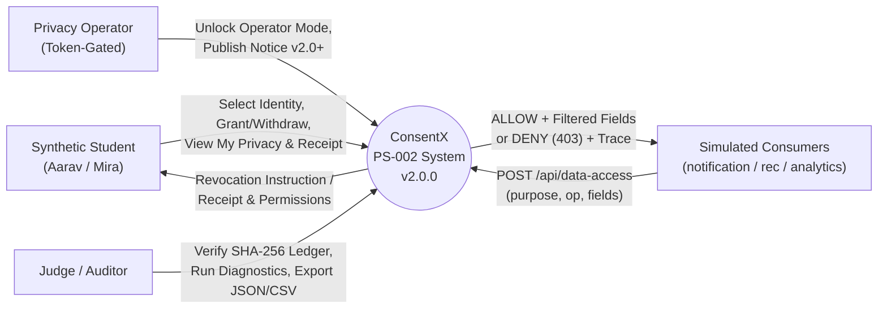
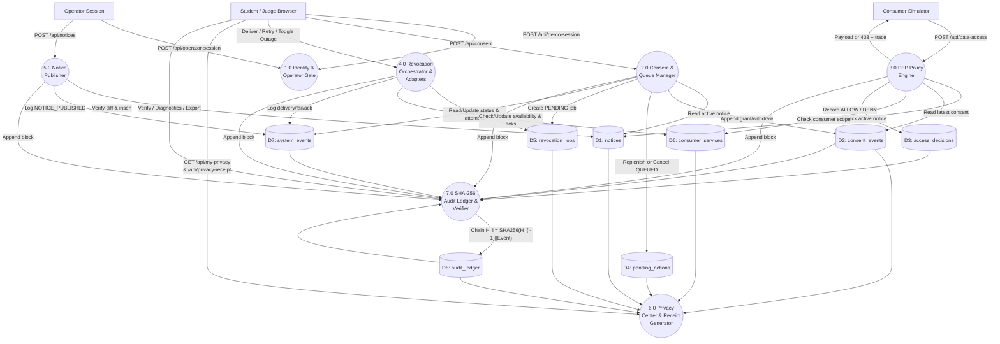
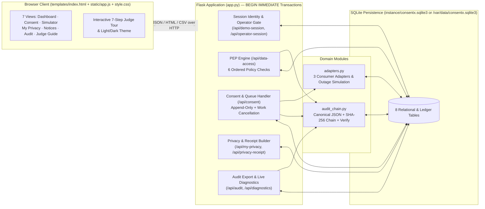
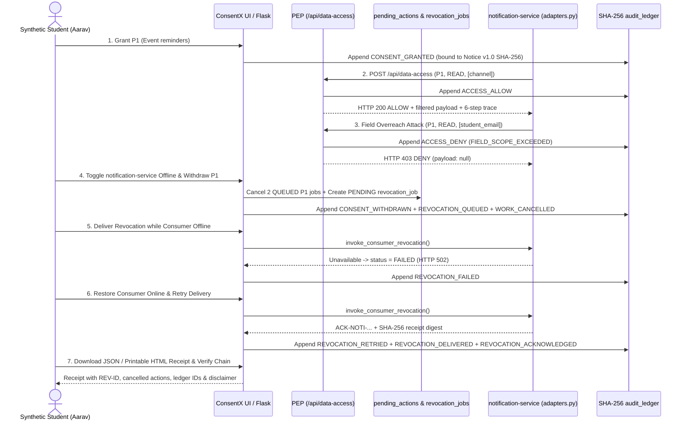
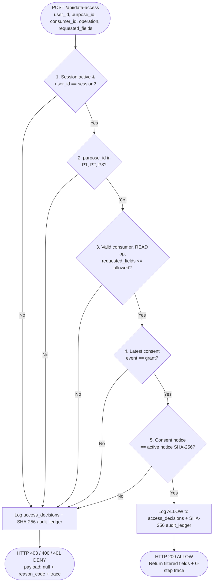
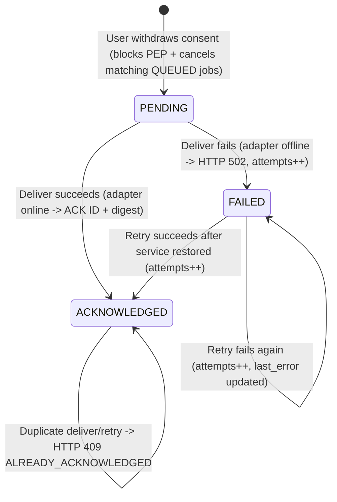

# ConsentX — Purpose-Based Consent Recording, Policy Enforcement & Downstream Revocation Prototype

**Problem Statement:** `PS-002` — Purpose-Based Consent Recording and Withdrawal Prototype (`../PS-002.pdf`)  
**Synthetic Service:** **CampusPulse** (University Event Platform)  
**Version:** `2.0.0` · **Automated Suite:** `52 / 52 passing` · **Live Diagnostics:** `8 / 8 checks`  
**Master Demo & Pitch Guide:** [`DEMO.md`](DEMO.md) · **One-Command Launcher:** [`start.sh`](start.sh)

> **Honest Scope Boundary:** ConsentX uses **synthetic users and synthetic data only**. It is built to demonstrate and verify **technical consent enforcement, downstream revocation orchestration, and tamper-evident audit evidence** for `PS-002`. It does **not** claim legal certification, real-world third-party integrations, or universal DPDP/GDPR compliance.

---

## Table of Contents

1. [Quick Start (`./start.sh`)](#-quick-start-running-consentx-locally)
2. [Automated Verification & Live Diagnostic Suite](#-automated-verification--live-diagnostic-suite)
3. [The Problem & Why ConsentX Exists (Start to End)](#the-problem--why-consentx-exists-start-to-end)
4. [Core Concepts & Architectural Rationale ("Why That?")](#core-concepts--architectural-rationale-why-that)
5. [System Architecture, Data Flow Diagrams (DFD) & Workflows](#system-architecture-data-flow-diagrams-dfd--workflows)
6. [Complete Feature & UI View Reference (What · Why · How)](#complete-feature--ui-view-reference-what--why--how)
7. [Demo Reference & 7-Step Judge Walkthrough](#demo-reference--7-step-judge-walkthrough)
8. [Database Schema (8 SQLite Tables) & Complete API Reference](#database-schema-8-sqlite-tables--complete-api-reference)
9. [PS-002 Requirements Checklist (`R-01` to `R-11`)](#ps-002-requirements-checklist-r-01-to-r-11)
10. [Production Deployment (Render)](#production-deployment-render)
11. [Repository Structure & Documentation Index](#repository-structure--documentation-index)

---

## ⚡ Quick Start: Running ConsentX Locally

ConsentX is completely self-contained. On first launch, it automatically creates a local SQLite database (`instance/consentx.sqlite3`), seeds **Privacy Notice `v1.0`** with its SHA-256 hash, seeds **3 purpose-isolated consumer adapters**, and queues **6 initial synthetic jobs** across **2 synthetic student identities**. Zero external databases, Node toolchains, or cloud accounts are required.

### Option 1: One-Command Installer & Launcher (`./start.sh`) — Recommended

```bash
cd consentx
chmod +x start.sh
./start.sh
```

What `./start.sh` automates from start to finish:
1. Checks that `python3` is installed.
2. Creates an isolated virtual environment in `.venv/` (if missing).
3. Installs/syncs Python dependencies from [`requirements.txt`](requirements.txt) (`Flask`, `gunicorn`).
4. Exports safe local demo defaults (`CONSENTX_OPERATOR_TOKEN=demo-operator-secret`, `CONSENTX_SECRET_KEY=local-demo-secret`, `PORT=5001`) if not already set.
5. Launches the ConsentX server at **[http://127.0.0.1:5001](http://127.0.0.1:5001)**.

#### Useful `./start.sh` Flags

| Command | What It Does |
|---|---|
| `./start.sh` | Install/verify `.venv` & dependencies and start the local server on port `5001` |
| `./start.sh --clean` | Delete `instance/consentx.sqlite3` first for a fresh Notice `v1.0` demo baseline, then start |
| `./start.sh --test` | Run all **52** isolated automated tests first, then start the server if all pass |
| `./start.sh --test-only` | Install dependencies, run all **52** automated tests, and exit |
| `./start.sh --prod` | Launch using `gunicorn` (`--workers 1 --threads 4`) instead of Flask's dev server |
| `./start.sh --port 8080` | Bind the server to a custom port |
| `./start.sh --help` | Print full CLI usage and environment variable reference |

### Option 2: Manual Setup

```bash
cd consentx
python3 -m venv .venv
source .venv/bin/activate
pip install -r requirements.txt
rm -f instance/consentx.sqlite3
CONSENTX_OPERATOR_TOKEN=demo-operator-secret CONSENTX_SECRET_KEY=local-demo-secret python app.py
```

Open **[http://127.0.0.1:5001](http://127.0.0.1:5001)** in your browser.  
To unlock notice publishing in the **Notice versions** tab, enter the configured `CONSENTX_OPERATOR_TOKEN` (`demo-operator-secret` when using `./start.sh`). No default operator secret is hardcoded in `app.py`.

---

## 🧪 Automated Verification & Live Diagnostic Suite

### 1. Run the Full Unit & Lifecycle Suite (52 Isolated Tests)

Every test runs against a fresh, isolated temporary SQLite database (never touching your local demo database, proven by `test_25`):

```bash
./start.sh --test-only
# or directly:
.venv/bin/python -m unittest discover -s tests -v
```

**What the 52 automated tests verify (`tests/test_ps002.py`):**
- **Scope & Identity (`test_01`–`test_02`, `test_25`, `test_36`–`test_38`)**: Health/version, exact `P1`–`P3` catalog, 2 synthetic users, isolated test DB, session-pinned identity enforcement against JSON spoofing, operator-gated notice publishing, dynamic UI test count.
- **Consent & PEP Enforcement (`test_03`–`test_13`, `test_18`, `test_26`–`test_31`)**: Default-deny on missing consent, grant with notice hash, purpose isolation (`P1` never unlocks `P2`/`P3`), independent grants, immediate denial after withdrawal (`403 CONSENT_WITHDRAWN`, `payload: null`), notice change invalidation (`NOTICE_MISMATCH`), re-consent recovery, 6-step `decision_trace`, field overreach denial (`FIELD_SCOPE_EXCEEDED`), consumer-purpose mismatch (`CONSUMER_PURPOSE_MISMATCH`), non-`READ` denial (`OPERATION_NOT_ALLOWED`).
- **Concurrency (`test_32`)**: 16 parallel threads hitting `/api/data-access` under `BEGIN IMMEDIATE` produce 16 unique `request_id`s and 16 audit rows with zero locking failures.
- **Downstream Revocation & Queued Work (`test_33`–`test_35`, `test_43`–`test_47`)**: Withdrawal creates `PENDING` revocation job, cancels only matching user+purpose `QUEUED` jobs, delivers to online adapters (`ACKNOWLEDGED` + `ACK-...` + digest), records consumer outages honestly (`HTTP 502` + `FAILED`), retries cleanly (`FAILED → ACKNOWLEDGED`), and enforces strict idempotency (`HTTP 409 ALREADY_ACKNOWLEDGED`).
- **My Privacy, Receipts & Reset (`test_48`–`test_52`)**: Student permissions & unresolved warnings, downloadable JSON and HTML receipts with user isolation, `/api/diagnostics` & consent-guarded `/api/pending-actions/simulate`, `DEMO.md` + Judge Tour UI markers, and `/api/demo-reset`.
- **Audit, Filtering & SHA-256 Ledger (`test_14`–`test_17`, `test_20`–`test_24`, `test_39`–`test_42`)**: Combined timeline, JSON/CSV parity, user/purpose/decision filters, intact chain verification (`200`), and tampered/deleted row detection (`409 broken`).

### 2. In-Browser Live Diagnostics (`GET /api/diagnostics`)

Inside **Audit & verification → Live diagnostics**, click **Run live diagnostics** to execute **8 non-destructive runtime checks** against the live backend:

- `[PASS] CHK-01` — Database & health readiness (SQLite connected and responsive)
- `[PASS] CHK-02` — Exact 3-purpose `PS-002` scope (`Purposes = ['P1', 'P2', 'P3']`)
- `[PASS] CHK-03` — Registered downstream consumer adapters (3 purpose-isolated adapters seeded)
- `[PASS] CHK-04` — Active notice SHA-256 verification (stored digest matches exact notice text)
- `[PASS] CHK-05` — Tamper-evident audit ledger chain (all ledger records link from genesis `0x00..00` with valid SHA-256 hashes)
- `[PASS] CHK-06` — Session identity boundary (active demo identity pinned in signed Flask session)
- `[PASS] CHK-07` — Operator notice-publish gate (`CONSENTX_OPERATOR_TOKEN` check; student mode cannot publish)
- `[PASS] CHK-08` — Isolated automated lifecycle suite (`>= 12` required; `52` tests defined)

---

## The Problem & Why ConsentX Exists (Start to End)

### The Real-World Failure Mode

Imagine a student, **Aarav**, joins **CampusPulse** and consents to **Event reminders (`P1`)**. Two weeks later, he clicks **Withdraw**. In typical consent-toggle demos or poorly engineered apps, this is what breaks:

```text
Typical broken app:
  User clicks "Withdraw" ──▶ DB sets consent_reminders = false
                             (AND STOPS THERE!)
                             [X] Queued reminder jobs still fire.
                             [X] Downstream notification service never learns of the withdrawal.
                             [X] Next API call may still read stale cached consent or ignore field scope.
                             [X] Overwriting a boolean destroys historical proof of what notice was active.
                             [X] User receives zero proof that anything actually stopped.
```

### Why `PS-002` Demands Real Enforcement + Auditability

Privacy regulations such as **India's Digital Personal Data Protection (DPDP) Act, 2023** and **GDPR** establish two concrete engineering requirements that `PS-002` tests in a controlled synthetic environment:
1. **Purpose Limitation & Data Minimization:** Consenting to *Event reminders* (`P1`) does **not** authorize *Personalized event suggestions* (`P2`), *Anonymous usage analytics* (`P3`), or extra fields like `student_email`.
2. **Enforceable Withdrawal & Accountability:** Withdrawing consent must block future data release **at request time**, halt queued work for that purpose, notify the responsible downstream consumer, and preserve verifiable, non-repudiable evidence.

### Why ConsentX Is More Than a Static Checkbox (Capability Comparison)

| Capability | Typical Static Checkbox | Basic Consent DB Toggle | **ConsentX v2.0.0** |
|---|---|---|---|
| Strict `PS-002` 3-purpose isolation | Often hardcoded | 3–4 purposes | **Exact 3 (`P1`, `P2`, `P3`)** |
| Server-side session identity pinning | None | Rare | **Signed Flask session (`IDENTITY_MISMATCH` 403)** |
| Consumer service & `READ`-only check | None | None | **`notification`, `recommendation`, `analytics`** |
| Field-level scope authorization | None | None | **`FIELD_SCOPE_EXCEEDED` blocks `student_email`** |
| Explainable 6-step decision trace | None | None | **Every `POST /api/data-access` returns `decision_trace`** |
| Cancels queued jobs on withdrawal | None | None | **Purpose- & user-scoped (`QUEUED → CANCELLED`)** |
| Downstream adapter delivery & ACK | None | None | **`PENDING → ACKNOWLEDGED` (`ACK-...` + digest)** |
| Honest consumer outage & idempotent retry | None | None | **`HTTP 502 FAILED` + `RETRY` + `409` idempotency** |
| Student **My Privacy** + downloadable receipt | None | None | **JSON + Printable HTML/PDF Receipt + disclaimer** |
| Tamper-evident SHA-256 audit ledger | None | Rare | **Unified 12-event hash chain + `/api/audit/verify`** |
| Operator-gated notice versioning | None | Rare | **`CONSENTX_OPERATOR_TOKEN` + `NOTICE_MISMATCH`** |
| In-browser live diagnostics + isolated tests | None | Rare | **8 live checks + 52 isolated tests** |

---

## Core Concepts & Architectural Rationale ("Why That?")

Every architectural choice in ConsentX exists to close a specific security, correctness, or auditability gap:

### 1. Purpose Isolation (`P1`, `P2`, `P3`) — *Why no global consent flag?*
Consent is never stored as `is_consented = true`. Each `(user_id, purpose_id)` pair has its own independent event stream and consumer binding:

| Purpose ID | Purpose Name | Consumer Adapter (`consumer_id`) | Queued Job Type | Authorized Fields Only (`READ`) |
|---|---|---|---|---|
| **`P1`** | Event reminders | `notification-service` | `event_reminder` | `channel`, `upcoming_event_ids` |
| **`P2`** | Personalized event suggestions | `recommendation-service` | `event_recommendation` | `synthetic_interests`, `suggested_event_ids` |
| **`P3`** | Anonymous usage analytics | `analytics-service` | `analytics_export` | `aggregation`, `feature_use_counts` |

Granting `P1` leaves `P2` and `P3` `Not granted`. Withdrawing `P1` blocks `notification-service` while leaving `P2` and `P3` untouched.

### 2. Append-Only Event History — *Why events instead of `UPDATE consent SET granted=0`?*
`consent_events` is strictly append-only. A withdrawal inserts a new `withdraw` row rather than mutating or deleting the prior `grant` row. The active state for `(user_id, purpose_id)` is always derived from `ORDER BY id DESC LIMIT 1`.
- **Why:** Overwriting a boolean erases forensic history—you can no longer prove *when* a student granted consent, *which* notice version they saw, or *when* they withdrew.

### 3. Policy Enforcement Point (PEP) at Request Time — *Why server-side 6-step evaluation?*
Hiding a UI button is not authorization. Every downstream data fetch must pass through `POST /api/data-access`, which runs **6 deterministic, fail-closed checks** inside a write-locked SQLite transaction:
1. **Identity Check**: Session must have an active demo identity (`401 NO_DEMO_IDENTITY`), `user_id` must be in `DEMO_USERS` (`403 UNKNOWN_USER`), and `user_id` must match the session-pinned user (`403 IDENTITY_MISMATCH`).
2. **Purpose Check**: `purpose_id` must be one of `{P1, P2, P3}` (`400 INVALID_PURPOSE`).
3. **Consumer, Operation & Field Scope Check**:
   - `requested_fields` must be a non-empty list of strings (`403 INVALID_REQUEST`).
   - `consumer_id` must be authorized for `purpose_id` (`403 CONSUMER_PURPOSE_MISMATCH`).
   - `operation` must equal `"READ"` (`403 OPERATION_NOT_ALLOWED`).
   - `set(requested_fields)` must be a subset of `allowed_fields` (`403 FIELD_SCOPE_EXCEEDED`).
4. **Latest Consent Check**: Latest `consent_events` row must exist (`403 NO_ACTIVE_CONSENT`) and have `action == "grant"` (`403 CONSENT_WITHDRAWN`).
5. **Active Notice Binding Check**: Consent's `(notice_version, notice_hash)` must match the latest `notices` row (`403 NOTICE_MISMATCH`).
6. **Field-Filtered Payload Release**: Only if all checks pass (`ACTIVE_CONSENT`) does the server return `HTTP 200` with *only* the requested subset of fields. Every `ALLOW` and `DENY` is logged to `access_decisions` and `audit_ledger` before returning, alongside a 6-step `decision_trace`.

### 4. Versioned Privacy Notices + SHA-256 Digest + Operator Gate
Every notice stores its exact UTF-8 text and `SHA-256(text)`.
- **Why SHA-256?** Proves mathematically which exact wording was active when consent was given. Publishing identical text is rejected (`400 UNCHANGED_NOTICE`); reusing an existing version is rejected (`409 VERSION_EXISTS`).
- **Why invalidate on change?** When an operator publishes `v2.0`, prior `v1.0` grants immediately fail check #5 (`NOTICE_MISMATCH`) until the student explicitly re-confirms under `v2.0`.
- **Why an Operator Gate (`CONSENTX_OPERATOR_TOKEN`)?** A student session cannot escalate itself to edit privacy policies (`403 OPERATOR_AUTH_REQUIRED`). Unlocking `/api/operator-session` uses constant-time `secrets.compare_digest()`. Switching demo users resets `session["role"] = "student"`.

### 5. Session-Pinned Synthetic Identity — *Why not trust `user_id` in the JSON body?*
A naive API that trusts `{"user_id": "student-002"}` lets `student-001` read or revoke `student-002`'s privacy state. ConsentX pins `session["user_id"]` in a signed Flask cookie via `POST /api/demo-session`. Any request passing a different `user_id` is rejected with `403 IDENTITY_MISMATCH` and audited.

### 6. Downstream Revocation Orchestration, Queue Cancellation & Honest Outages
Stopping future `POST /api/data-access` calls is only half the story. When `POST /api/consent` records a `withdraw` event, inside the **exact same atomic transaction** it:
1. Cancels all `QUEUED` jobs in `pending_actions` matching `(user_id, purpose_id, consumer_id)` (`QUEUED → CANCELLED`, linked to `revocation_id`). Other purposes (`P2`, `P3`) and other users stay `QUEUED`.
2. Creates a persistent instruction in `revocation_jobs` (`status='PENDING'`).
3. Logs `CONSENT_WITHDRAWN`, `REVOCATION_QUEUED`, and `WORK_CANCELLED` to `audit_ledger`.
4. **Delivery & Honest Outages (`adapters.py`)**: Delivering (`POST /api/revocations/<id>/deliver`) invokes the simulated consumer adapter:
   - **Online:** Records `DELIVERED → ACKNOWLEDGED`, generates `ACK-<CONSUMER>-<HEX>` and a SHA-256 `adapter_receipt_digest`, increments `revocations_processed`.
   - **Offline (Simulated Outage):** Returns `HTTP 502 CONSUMER_UNAVAILABLE`, marks the job `FAILED`, increments `attempts`, and preserves `last_error`. **ConsentX never fabricates a green success badge when a consumer is down.**
   - **Retry & Idempotency:** Restoring the consumer and calling `POST /api/revocations/<id>/retry` transitions `FAILED → ACKNOWLEDGED`. Re-delivering or re-retrying an `ACKNOWLEDGED` job returns `HTTP 409 ALREADY_ACKNOWLEDGED`.

### 7. Tamper-Evident SHA-256 Hash-Chain Audit Ledger (`audit_chain.py`)
`audit_ledger` unifies **12 event types** (`CONSENT_GRANTED`, `CONSENT_WITHDRAWN`, `ACCESS_ALLOW`, `ACCESS_DENY`, `NOTICE_PUBLISHED`, `REVOCATION_QUEUED`, `WORK_CANCELLED`, `REVOCATION_DELIVERED`, `REVOCATION_ACKNOWLEDGED`, `REVOCATION_FAILED`, `REVOCATION_RETRIED`, `CONSUMER_AVAILABILITY_CHANGED`) in a single append-only hash chain starting from `GENESIS_HASH = "0" * 64`:

$$H_i = \text{SHA256}\Big(H_{i-1} \;\big\|\; \texttt{||} \;\big\|\; \text{CanonicalJSON}(\text{Event}_i)\Big)$$

where `CanonicalJSON` uses `json.dumps(..., sort_keys=True, separators=(",", ":"), ensure_ascii=True)`.  
`GET /api/audit/verify` walks from row `#1` to the tip and returns `HTTP 409` pointing to `broken_at_id` if any row is edited, deleted, or reordered. *(Accurately termed **tamper-evident**, not tamper-proof, because an attacker with SQLite write access could recompute the entire chain if no external anchor exists.)*

### 8. Concurrency Control & Tech Stack Rationale
- **SQLite `BEGIN IMMEDIATE` (`db_session(write=True)`)**: Acquires SQLite's write lock *before* reading consent/notice/chain state so concurrent threads never deadlock upgrading a read snapshot to a write transaction (proven by `test_32` with 16 parallel threads).
- **Why Flask + SQLite + Vanilla JS/CSS?**: Zero build step, single-command launch, transparent server-side enforcement boundary, and persistent file storage on Render (`/var/data/consentx.sqlite3` via `render.yaml`) rather than ephemeral serverless `/tmp` storage. See [`docs/TECH_STACK.md`](docs/TECH_STACK.md).

---

## System Architecture, Data Flow Diagrams (DFD) & Workflows

### 1. Context Diagram (DFD Level 0)



### 2. Detailed Data Flow Diagram (DFD Level 1)



### 3. System Architecture Graph



### 4. End-to-End Lifecycle Sequence Diagram



### 5. PEP 6-Step Decision Flowchart (`POST /api/data-access`)



### 6. Revocation Job State Machine



---

## Complete Feature & UI View Reference (What · Why · How)

ConsentX is organized into **7 navigable workspace views**, a **persistent top bar** (identity switcher, light/dark theme toggle, and **Judge Tour** toggle), and **8 core backend capabilities**:

| # | UI View | What You Can Do Here | Backing Endpoints |
|---|---|---|---|
| 1 | **Dashboard** (`#dashboard`) | See live counts (Active Consents, Total Requests, Allows, Denies, Queued/Cancelled/Pending Revocations), active notice SHA-256, all 3 purpose statuses, consumer health cards, and latest PEP decision summary. | `GET /api/state`, `GET /api/audit`, `GET /api/revocations`, `GET /api/pending-actions` |
| 2 | **Consent & revocation** (`#consent`) | Grant or withdraw `P1`, `P2`, `P3` independently; simulate queueing new jobs (`+ Queue P1/P2/P3 job`); toggle simulated consumers Online/Offline; watch `QUEUED` jobs flip to `CANCELLED`; dispatch **Deliver to service** and **Retry delivery**; inspect `PENDING`/`FAILED`/`ACKNOWLEDGED` instructions. | `POST /api/consent`, `POST /api/pending-actions/simulate`, `POST /api/consumers/<id>/availability`, `POST /api/revocations/<id>/deliver`, `POST /api/revocations/<id>/retry` |
| 3 | **Data access simulator** (`#simulator`) | Simulate downstream consumer requests with custom consumer, purpose, operation (`READ`/`WRITE`), and field checkboxes—or click the **4 one-click Quick Demo Scenarios**: **Valid P1 read**, **Field overreach (`student_email`)**, **Wrong consumer mismatch**, and **Unauthorized WRITE**. View the 6-step `decision_trace` and JSON payload/denial. | `POST /api/data-access` |
| 4 | **My Privacy** (`#privacy`) | Student-facing privacy center showing granted vs. withdrawn permissions, connected services with authorized field tags, unresolved withdrawal alert banner vs. acknowledged status, and **JSON** / **Printable HTML/PDF** receipts (`templates/receipt.html`). | `GET /api/my-privacy`, `GET /api/privacy-receipt/<id>` |
| 5 | **Notice versions** (`#notices`) | Unlock operator mode using `CONSENTX_OPERATOR_TOKEN`, edit notice text, publish a new version (`v2.0`+), inspect newest-first notice history with timestamps and full SHA-256 digests, and observe prior grants become stale (`Re-consent needed` / `NOTICE_MISMATCH`). | `POST /api/operator-session`, `POST /api/notices` |
| 6 | **Audit & verification** (`#audit`) | Toggle between **Activity timeline** (paged 12 rows at a time, filterable by purpose and `ALLOW`/`DENY`) and **SHA-256 ledger** (`prev_hash → row_hash`), run **Verify audit integrity**, execute **Run live diagnostics** (`8/8`), and download filtered **JSON** or **CSV** audit exports. | `GET /api/audit`, `GET /api/audit/ledger`, `GET /api/audit/verify`, `GET /api/diagnostics` |
| 7 | **Judge Guide** (`#guide`) | In-app reference mapping all `PS-002` requirements, architecture summary, feature guide, and honest scope limits—plus the collapsible **7-Step Live Judge Tour** banner at the top with step auto-completion, **Restart tour**, and **Reset Demo Data**. | `POST /api/demo-reset` |

---

## Demo Reference & 7-Step Judge Walkthrough

For full pitch scripts, tough judge Q&A, and line-by-line enforcement pseudocode, refer to:
- **[Master Demo, Features, Architecture & Judge Guide (`DEMO.md`)](DEMO.md)**
- **[Personal Walkthrough & Demo Script (`docs/WALKTHROUGH.md`)](docs/WALKTHROUGH.md)**
- **[Judge Brief: Why the Mock Is the Point (`docs/JUDGE_BRIEF.md`)](docs/JUDGE_BRIEF.md)**
- **[Mentor Demo Pseudocode (`docs/DEMO_PSEUDOCODE.md`)](docs/DEMO_PSEUDOCODE.md)**

### 7-Step End-to-End Live Flow (Matches the In-App **Judge Tour**)

1. **Grant `P1` only:** In **Consent & revocation**, grant `P1` (*Event reminders*) for `Aarav Demo` (`student-001`). Verify `P2` and `P3` remain `Not granted`.
2. **Test Allowed `READ` & Field Overreach Attack:** In **Data access simulator**, run **Valid P1 read** (`HTTP 200 ALLOW`, 6 checks `PASS`, returns `channel` and `upcoming_event_ids`), then run **Field overreach (`student_email`)** (`HTTP 403 DENY`, `FIELD_SCOPE_EXCEEDED`, `payload: null`).
3. **Simulate Outage + Withdraw `P1` + Cancel Queued Work:** In **Consent & revocation**, toggle `notification-service` **Offline**, then click **Withdraw consent** on `P1`. Confirm 2 queued `P1` reminder jobs immediately become `CANCELLED` while `P2`/`P3` jobs stay `QUEUED`, and subsequent `P1` reads fail with `CONSENT_WITHDRAWN`.
4. **Honest Failure → Restore → Idempotent Retry:** Click **Deliver to service** while offline (`HTTP 502`, `status: FAILED`, `attempts: 1`). Toggle `notification-service` back **Online**, click **Retry delivery** (`HTTP 200`, `status: ACKNOWLEDGED`, `ACK-...` + receipt digest).
5. **Inspect My Privacy & Downloadable Receipt:** Open **My Privacy**, verify `notification-service` authorization is off, open **Printable receipt** (and **JSON receipt**) showing `REV-...`, cancelled action IDs, notice SHA-256, linked ledger IDs, and the explicit erasure disclaimer.
6. **Publish Notice `v2.0` (Operator Gate):** Open **Notice versions**, enter `demo-operator-secret`, edit the notice text, and publish `v2.0`. Observe any active `v1.0` grant now shows `Re-consent needed` and fails PEP with `NOTICE_MISMATCH` until re-confirmed.
7. **Verify SHA-256 Ledger & Live Diagnostics:** Open **Audit & verification**, click **Verify audit integrity** (`INTACT`), click **Run live diagnostics** (`8/8 PASS`), and export **JSON** / **CSV**.

---

## Database Schema (8 SQLite Tables) & Complete API Reference

### The 8 SQLite Tables (`app.py`)

| Table | Purpose | Key Fields |
|---|---|---|
| `notices` | Immutable privacy notice versions | `version` (PK), `text`, `sha256`, `created_at` |
| `consent_events` | Append-only grant/withdraw history | `event_id`, `user_id`, `purpose_id`, `action`, `notice_version`, `notice_hash`, `created_at` |
| `access_decisions` | Every PEP `ALLOW`/`DENY` evaluation | `request_id`, `user_id`, `purpose_id`, `decision`, `reason_code`, `consumer_id`, `operation`, `requested_fields` |
| `system_events` | Operational & lifecycle events | `event_id`, `event_type`, `details`, `notice_version`, `notice_hash`, `created_at` |
| `revocation_jobs` | Downstream withdrawal instructions | `revocation_id`, `withdrawal_event_id`, `consumer_id`, `status`, `attempts`, `adapter_event_id`, `adapter_receipt_digest`, `last_error`, `pending_actions_cancelled` |
| `pending_actions` | Synthetic queued consumer jobs | `action_id` (PK), `user_id`, `purpose_id`, `consumer_id`, `action_type`, `status` (`QUEUED`/`CANCELLED`/`COMPLETED`), `revocation_id` |
| `consumer_services` | Simulated adapter availability & stats | `consumer_id` (PK), `purpose_id`, `allowed_fields`, `available`, `revocations_processed`, `last_ack_event_id` |
| `audit_ledger` | Unified SHA-256 hash-chained ledger | `id`, `event_id`, `event_type`, `user_id`, `purpose_id`, `consumer_id`, `details`, `prev_hash`, `row_hash`, `created_at` |

### Complete API Reference (All 23 Endpoints)

| Method & Path | Description | Auth / Policy Boundary |
|---|---|---|
| `GET /` | Render CampusPulse SPA workspace | Seeds default session `student-001` if unset |
| `GET /api/health` | Service health, version, test count, ledger integrity | Public |
| `GET /api/demo-session` | Get current session-pinned synthetic identity & role | Active session (`401` if unset) |
| `POST /api/demo-session` | Switch synthetic identity (`student-001` / `student-002`); resets role to `student` | Allowlisted `DEMO_USERS` (`400` otherwise) |
| `POST /api/operator-session` | Unlock operator role for notice publishing | Constant-time check against `CONSENTX_OPERATOR_TOKEN` (`403` / `503`) |
| `POST /api/demo-reset` | Wipe all 8 tables and re-seed clean Notice `v1.0` baseline | Active session |
| `GET /api/state` | Purposes, latest consents, notice history, consumers, ledger status | Session identity match (`403 IDENTITY_MISMATCH`) |
| `POST /api/consent` | Record `grant` or `withdraw`; on withdraw, cancel `QUEUED` jobs & create `PENDING` revocation | Session identity match |
| `POST /api/data-access` | 6-check PEP endpoint returning filtered payload or `403` + `decision_trace` | Session identity match + scope + consent + notice |
| `GET /api/revocations` | List user's downstream revocation instructions | Session identity match |
| `POST /api/revocations/<id>/deliver` | Dispatch `PENDING` revocation to consumer adapter (`200` / `502`) | Session identity + owner + `409` idempotency |
| `POST /api/revocations/<id>/retry` | Retry `FAILED` revocation instruction (`200` / `502`) | Session identity + `FAILED` check + `409` idempotency |
| `GET /api/consumers` | List the 3 simulated consumer adapters and availability | Public |
| `POST /api/consumers/<id>/availability` | Toggle consumer online/offline (`{"available": bool}`) for outage demo | Active session |
| `GET /api/pending-actions` | List user's `QUEUED`/`CANCELLED`/`COMPLETED` synthetic jobs | Session identity match |
| `POST /api/pending-actions/simulate` | Queue a new synthetic job for a purpose | Session identity + requires active consent (`403 CONSENT_REQUIRED`) |
| `GET /api/my-privacy` | Student-facing permissions, connected services, unresolved withdrawals | Session identity match |
| `GET /api/privacy-receipt/<id>` | Downloadable JSON (`format=json&download=1`) or printable HTML receipt (`format=html`) | Session identity + receipt ownership (`403`) |
| `POST /api/notices` | Publish new notice version + SHA-256 hash | Operator session required (`403`), unique version (`409`), changed text (`400`) |
| `GET /api/audit` | Filtered combined timeline export (`format=json` or `format=csv`) | Session identity match + filter validation |
| `GET /api/audit/ledger` | Return user + system SHA-256 chained `audit_ledger` rows + verify result | Active session |
| `GET /api/audit/verify` | Walk every row from genesis to tip and verify SHA-256 chain (`200` / `409`) | Public |
| `GET /api/diagnostics` | Run 8 non-destructive live backend checks (`CHK-01`–`CHK-08`) | Public |

---

## PS-002 Requirements Checklist (`R-01` to `R-11`)

Source specification: `../PS-002.pdf` (detailed tracking in [`docs/REQUIREMENTS.md`](docs/REQUIREMENTS.md) and [`docs/PROGRESS.md`](docs/PROGRESS.md)).

| Req ID | Requirement | ConsentX Implementation & Verification Proof |
|---|---|---|
| **R-01** | Single synthetic service & synthetic users | **CampusPulse** with `student-001` (Aarav Demo) and `student-002` (Mira Demo); `test_02`, `test_25`, `test_36`. |
| **R-02** | Exactly 3 itemized purposes | Strict `{P1, P2, P3}` catalog enforced in backend, PEP, adapters, and UI; `test_02`, `test_06`, `test_07`. |
| **R-03** | Record grant and withdrawal history | Append-only `consent_events` table preserving all prior rows; `test_04`, `test_08`, `test_14`. |
| **R-04** | Versioned privacy notices with SHA-256 | Immutable `notices` table + SHA-256 verification + `NOTICE_MISMATCH` invalidation; `test_10`, `test_11`, `test_17`, `test_28`. |
| **R-05** | Mock downstream API checks consent at request time | 6-step PEP in `POST /api/data-access` with consumer, `READ`, and field-level checks; `test_03`, `test_05`, `test_26`, `test_29`–`test_32`. |
| **R-06** | Withdrawal blocks next requests & isolates others | Immediate `403 CONSENT_WITHDRAWN` (`payload: null`) + queued job cancellation + downstream delivery; `test_08`, `test_09`, `test_27`, `test_44`. |
| **R-07** | Audit records + JSON and CSV exports | Unified timeline + SHA-256 `audit_ledger` + filtered JSON/CSV exports; `test_14`–`test_16`, `test_20`–`test_24`, `test_39`–`test_42`. |
| **R-08** | At least 12 automated lifecycle tests | **52 isolated automated tests** pass on temporary SQLite DBs (`evidence/test-results.txt`). |
| **R-09** | End-to-end demonstration flow | Covered by 7-step in-app **Judge Tour**, [`DEMO.md`](DEMO.md), and [`docs/WALKTHROUGH.md`](docs/WALKTHROUGH.md). |
| **R-10** | Pseudocode matching enforcement logic | [`docs/DEMO_PSEUDOCODE.md`](docs/DEMO_PSEUDOCODE.md) aligned directly with `app.py`. |
| **R-11** | Submission packaging | `render.yaml`, `README.md`, `DEMO.md`, `evidence/`, and checklist tracked in [`docs/PROGRESS.md`](docs/PROGRESS.md). |

---

## Production Deployment (Render)

[`render.yaml`](render.yaml) configures a persistent single-instance WSGI deployment because serverless platforms with read-only filesystems or ephemeral `/tmp` directories drop SQLite consent records and SHA-256 hash chains across cold starts:

- **Build command:** `pip install -r requirements.txt`
- **Start command:** `gunicorn app:app --bind 0.0.0.0:$PORT --workers 1 --threads 4`
- **Health check:** `/api/health`
- **Persistent disk:** `consentx-data` mounted at `/var/data` (`CONSENTX_DB=/var/data/consentx.sqlite3`, `1 GB`)
- **Secrets:** Auto-generated `CONSENTX_SECRET_KEY` and `CONSENTX_OPERATOR_TOKEN`

---

## Repository Structure & Documentation Index

```text
consentx/
├── README.md                  # Complete system, architecture, DFD, API, and setup guide (this file)
├── DEMO.md                    # Master Demo, Features, USP, Pitch Script & Judge Q&A
├── start.sh                   # One-command macOS/Linux installer, test runner & server launcher
├── VERSION                    # Semantic version (2.0.0)
├── requirements.txt           # Flask & Gunicorn dependencies
├── render.yaml                # Render persistent-disk WSGI deployment blueprint
├── app.py                     # Flask app, 8-table SQLite schema, 6-step PEP & 23 routes
├── adapters.py                # 3 simulated downstream consumer adapters & outage/ack logic
├── audit_chain.py             # Tamper-evident SHA-256 canonical JSON hash-chain ledger
├── templates/
│   ├── index.html             # 7-view CampusPulse workspace + Judge Tour + dark/light theme
│   └── receipt.html           # Print-friendly HTML/PDF student withdrawal receipt
├── static/
│   ├── app.js                 # Frontend state, simulator presets, Judge Tour & diagnostics UI
│   └── style.css              # Design tokens, light/dark theme variables & responsive layout
├── tests/
│   └── test_ps002.py          # 52 isolated automated lifecycle, security, concurrency & ledger tests
├── evidence/
│   ├── test-results.txt       # Recorded output of all 52 passing tests
│   └── ...                    # Captured API, export, and milestone verification logs
└── docs/
    ├── ARCHITECTURE.md        # Architecture overview & enforcement boundary
    ├── TECH_STACK.md          # Flask / SQLite / Vanilla JS trade-offs & rationale
    ├── REQUIREMENTS.md        # PS-002 acceptance criteria & explicit out-of-scope boundary
    ├── DEMO_PSEUDOCODE.md     # Request-time PEP & revocation orchestration pseudocode
    ├── JUDGE_BRIEF.md         # Concise 30-second pitch & scope defense
    ├── WALKTHROUGH.md         # Step-by-step manual walkthrough script
    ├── TEST_PLAN.md           # Feature-by-feature test matrix
    ├── RELEASES.md            # Changelog from v1.0.0 to v2.0.0
    ├── ROADMAP_v1.7.md        # v1.7 / v2.0 architectural roadmap
    ├── TASKS.md               # Detailed engineering task breakdown
    ├── DECISIONS.md           # Architectural decision log
    ├── EVIDENCE.md            # Evidence artifact index
    └── PROGRESS.md            # Overall milestone & requirement status tracker
```
