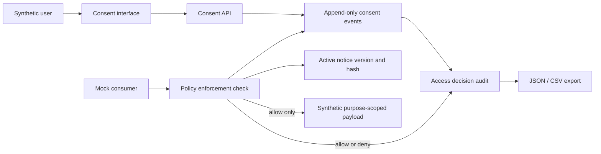

# Architecture (planned)

## Request path

## Enforcement order

1. Validate request shape and that purpose is one of P1–P3.
2. Resolve the authenticated synthetic user; do not trust a caller-supplied user ID as authentication.
3. Load the latest event for that user-purpose pair.
4. Deny if no grant exists, latest action is withdrawal/denial, state cannot be verified, or consent notice version/hash is stale.
5. Only after all checks pass, construct and return that purpose's synthetic payload.
6. Append an access decision with request ID, user, purpose, allow/deny, reason code, UTC timestamp and notice reference.

## Data model (initial proposal)

- `users`: synthetic user ID and display name.
- `purposes`: exactly P1, P2 and P3, with description and payload boundary.
- `notices`: immutable version, text and SHA-256 hash.
- `consent_events`: append-only grant/withdraw/deny event, user, purpose, notice reference and timestamp.
- `access_decisions`: request ID, user, purpose, result, reason, timestamp and notice reference.

Persist the event history; do not overwrite the only consent record with a mutable boolean. Decide the final database/framework in T-003 before implementation.

## Current technology choice

ConsentX currently uses Flask, SQLite, Jinja templates, browser JavaScript and CSS. The reasons and alternatives are documented in [`TECH_STACK.md`](TECH_STACK.md). The choice is suitable for the local prototype, but clean setup and behavior still need verification under T-003.

- Keep the mock consumer and policy check in the same demo system initially; clearly label the policy boundary so a later separate consumer can call the API.
- No real third-party network calls or real personal data.
