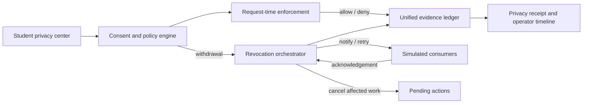
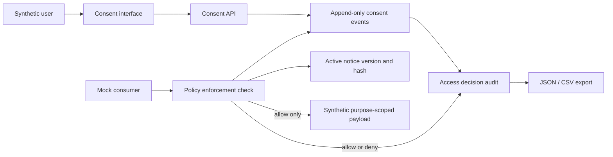

# ConsentX Architecture (v1.7.0-dev4)

## Planned direction

The implemented path includes the PS-002 consent and request-time enforcement prototype, a pending revocation queue, and purpose-scoped cancellation of synthetic queued work. Later v1.7 tasks add adapter delivery, acknowledgements, retries, and user-readable receipts. See [`ROADMAP_v1.7.md`](ROADMAP_v1.7.md); planned components below must not be read as implemented components.

Implemented in v1.7.0-dev4 so far: student routes use a signed Flask session identity; notice publication requires a separate operator session unlocked by a configured environment token. Each withdrawal writes a purpose-mapped pending job and `REVOCATION_QUEUED` system event in the same SQLite transaction as the consent event, then cancels only that user's queued actions for the withdrawn purpose. The user-filtered `/api/revocations` and `/api/pending-actions` endpoints and Consent Management list expose the stored state. Adapter delivery and acknowledgement remain planned. The selectable synthetic identity is not real account authentication.

## Request path

## Enforcement order

1. Validate request shape and that purpose is one of P1–P3.
2. Resolve the authenticated synthetic user; do not trust a caller-supplied user ID as authentication.
3. Load the latest event for that user-purpose pair.
4. Deny if no grant exists, latest action is withdrawal/denial, state cannot be verified, or consent notice version/hash is stale.
5. Only after all checks pass, construct and return that purpose's synthetic payload.
6. Append an access decision with request ID, user, purpose, allow/deny, reason code, UTC timestamp and notice reference.

## Data model (initial proposal)

- `users`: synthetic user ID and display name.
- `purposes`: exactly P1, P2 and P3, with description and payload boundary.
- `notices`: immutable version, text and SHA-256 hash.
- `consent_events`: append-only grant/withdraw/deny event, user, purpose, notice reference and timestamp.
- `access_decisions`: request ID, user, purpose, result, reason, timestamp and notice reference.

Persist the event history; do not overwrite the only consent record with a mutable boolean. Decide the final database/framework in T-003 before implementation.

## Judge-facing request trace

The `POST /api/data-access` response includes a `decision_trace` alongside its original decision and payload fields. It reports synthetic-user recognition, exact purpose scope, latest consent event, notice match, and whether the payload was released or withheld. The trace is built from the same server-side checks that decide the response. It is explanatory evidence; it does not replace or weaken enforcement.

The browser UI is organized into Dashboard, Consent Management, Data Access Simulator, Notice Versions, and Audit & Tests views. Dashboard access counts are derived from persisted audit rows. The notice view presents the stored text, version, timestamp, and digest for each publication.

## Current technology choice

ConsentX currently uses Flask, SQLite, Jinja templates, browser JavaScript and CSS. The reasons and alternatives are documented in [`TECH_STACK.md`](TECH_STACK.md). The choice is suitable for the local prototype, but clean setup and behavior still need verification under T-003.

- Keep the mock consumer and policy check in the same demo system initially; clearly label the policy boundary so a later separate consumer can call the API.
- No real third-party network calls or real personal data.

## Test and demo database boundary

- A normal app run uses `instance/consentx.sqlite3`, unless the operator sets `CONSENTX_DB` to a different explicit path.
- Each lifecycle test patches the database path to a unique temporary directory and enables Flask's `TESTING` setting only for that test fixture. Teardown restores the prior setting and removes the temporary directory.
- The application has no test-only consent bypass, mock authorization switch, or test endpoint. Browser requests and automated client requests use the same enforcement routes.
- Test evidence: `tests/test_ps002.py::test_25_test_fixture_isolated_from_demo_database` and `evidence/test-results.txt`.
