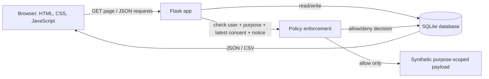

# ConsentX Architecture and Technology Choices

## Architecture at a glance

ConsentX is one small web application for a synthetic service. The browser renders the consent screen and mock consumer controls. Flask serves that screen and the JSON endpoints. SQLite stores notice versions, append-only consent events and access decisions. The enforcement endpoint checks the latest event and active notice before it returns a purpose-specific synthetic payload.

The decision boundary is server-side: hiding or disabling a browser button is not authorization. Every mock data request must go through the Flask enforcement route.

## Why this stack for this project

### Flask for the backend

Flask is a lightweight Python web framework with routing, request/response handling, static-file support and Jinja template rendering. That maps closely to this prototype: one page, a handful of JSON endpoints and a small local run command. Flask's official quickstart demonstrates routes, static files and template rendering in the same app ([Flask quickstart](https://flask.palletsprojects.com/en/stable/quickstart/)).

For ConsentX, Flask keeps the implementation path short: UI page, consent events, access checks and exports can be developed in one Python project. It is not selected because it is inherently more secure or faster than other frameworks; security comes from the checks and tests we implement.

### Why not FastAPI right now?

FastAPI is also a good Python backend choice. It provides type-hint-driven request validation and automatic OpenAPI/interactive API documentation ([FastAPI features](https://fastapi.tiangolo.com/features/)). Those are valuable when the API contract is central, when several clients consume it, or when the API surface is expected to grow.

For the current hackathon slice, the API is small and the same team builds the browser client. FastAPI would be reasonable, but switching now adds framework migration and setup work without closing a missing PS-002 requirement. Choose FastAPI instead if we add a separate mobile/client integration, need a formal public API contract, or the endpoint set grows substantially.

### Why not React right now?

React is a UI library for building component-based interfaces; it is not a replacement for Flask or FastAPI on the backend. React can make sense if the interface grows into multiple complex screens with shared state and reusable interactive components ([React documentation](https://react.dev/learn/describing-the-ui)).

ConsentX currently has one screen with three purpose cards, a request panel and an audit list. HTML templates plus a small JavaScript file are enough to show the required lifecycle. A React frontend would add a Node/package-manager build, client/server integration and more setup for the same demo behavior. We can adopt React later if the interface complexity justifies that cost; the consent API should remain a separate server-side contract either way.

### Why SQLite?

The demo uses one local process, synthetic data and a small record set. SQLite stores data in a file and avoids a separate database service, which makes clean local demos easier. It is not the right assumption for every deployment: if we host multiple app instances, need concurrent multi-user operation, or need managed backups, move to a managed relational database such as PostgreSQL and verify migrations/persistence.

### Why browser JavaScript and CSS?

They let the current page call the JSON API and refresh consent/audit state without introducing a frontend build system. The browser only presents choices and results; all authorization decisions stay in Flask.

## Trade-offs and limits

- Current stack optimizes for a small local prototype and a clear demo, not production scale.
- Flask's built-in development server is for local development; deployment requires a production WSGI server/host ([Flask deployment guidance](https://flask.palletsprojects.com/en/stable/deploying/)).
- SQLite is currently local persistence; hosted persistence and concurrency need a separate deployment decision.
- No stack choice by itself proves PS-002 compliance. Passing lifecycle tests and saved evidence do.

## When to reconsider

Revisit the stack only when a concrete need appears: multiple independent clients/API consumers (consider FastAPI), a larger interactive multi-screen interface (consider React), or multi-instance hosted persistence (consider PostgreSQL). Record any change and its migration/test proof in `DECISIONS.md` and `TASKS.md`.
